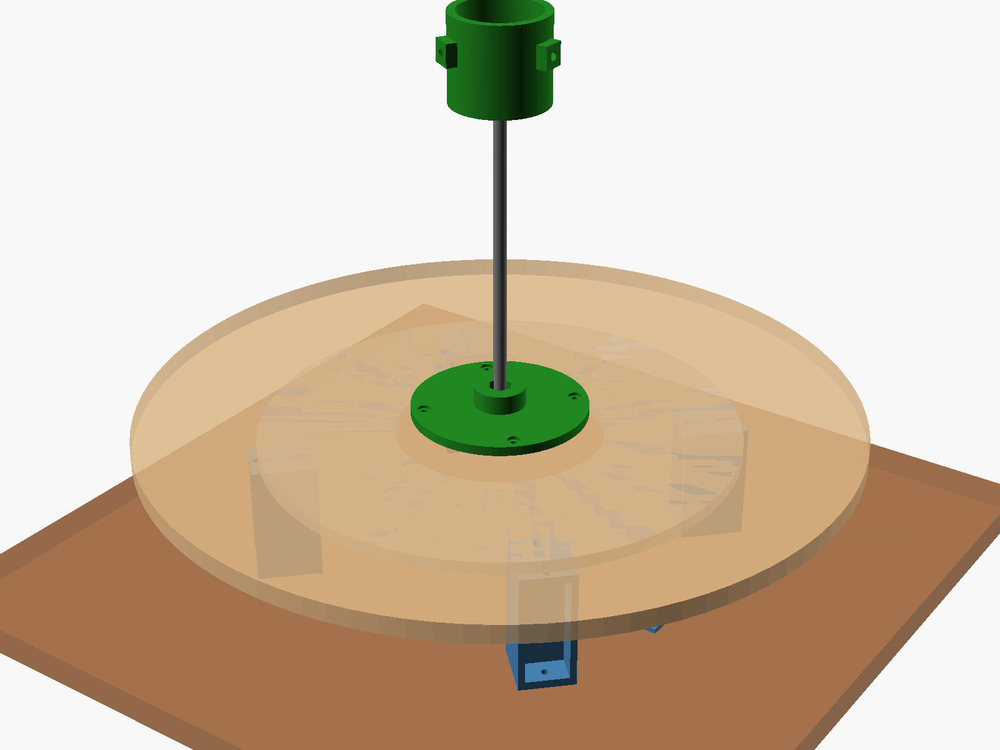
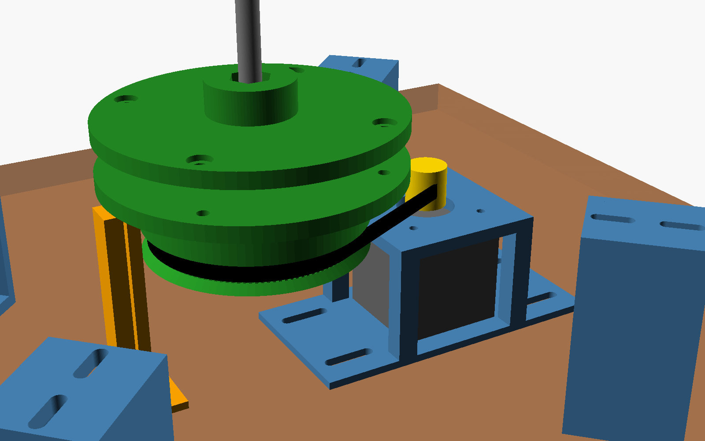

# PhenoForge motorised turntable

This is a stop-and-shoot turntable for 3D imaging of root crowns (cassava-style) and potted
plants. The camera stays still while the sample turns. A Raspberry Pi 5 drives the turntable
and takes a photo at every stop. PhenoForge then masks the static room and reconstructs the
sample with COLMAP.

- Platter: 450 mm, sized for root crowns about 60 cm across and up to about 5 kg.
- Drive: 6:1 GT2 belt. With 1/16 microstepping that gives 19 200 microsteps per turn,
  about 0.02° per microstep.
- Parts: seven printed parts in OpenSCAD (`turntable.scad`), so you can edit every size.
- Full procedure: SOP-5 in `docs/sop/`.

 

## Print (Bambu Lab X1 Carbon)

Open `bambu/plate1_drive_parts.3mf` and `bambu/plate2_risers_pot_ring.3mf` in Bambu
Studio. The parts are already oriented and placed on the 256 × 256 mm bed.

| Setting | Value |
|---|---|
| Printer / plate | X1 Carbon 0.4 mm nozzle, Textured PEI plate |
| Filament | PETG (Bambu PETG HF or Basic). PLA+ also works if the rig stays indoors |
| Process | 0.20 mm Standard, **4 walls**, **35 % gyroid** infill |
| Supports | none needed |
| Filament use | about 250 g (plate 1) and 265 g (plate 2) |

| File | Qty | What it does |
|---|---|---|
| `big_pulley` | 1 | 120T GT2 pulley that hangs under the platter through the bearing opening |
| `crown_hub` | 1 | Clamps the platter between itself and the pulley (4 × M4) and holds the M8 rod upright |
| `motor_cradle` | 1 | Holds the NEMA 17 face-up. Slotted feet tension the belt (±8 mm) |
| `riser` | 4 | Lift the bearing 75 mm off the base so the drive fits underneath |
| `stem_cup` | 1 | Sits on top of the rod and grips a 5–10 cm stem stub with 3 × M5 thumb screws |
| `pot_ring` | 1 | Centres a pot (150 mm by default; change `pot_d` for other sizes) |
| `home_sensor_post` | 1 | Optional. Holds a hall sensor under the magnet in the pulley flange |

To change a size, open `turntable.scad`, edit the parameters at the top, and export again:
`openscad -D 'part="pot_ring"' -D pot_d=120 -o stl/pot_ring.stl turntable.scad`. Then run
`python make_bambu.py` to rebuild the Bambu plates.

## Bought parts (about AUD 120–160)

| Part | Spec |
|---|---|
| Lazy-susan bearing | 300 mm (12"), ball bearing, rated ≥ 100 kg, **centre opening ≥ 120 mm**, about 8 mm thick |
| Stepper motor | NEMA 17, 40 mm body (17HS4401 or similar), 1.5–1.7 A |
| Driver | TMC2209 step-stick (quiet), or A4988 / DRV8825 |
| Pulley + belt | GT2 20T aluminium pulley with 5 mm bore, plus a **GT2 closed loop of 300 mm, 6 mm wide** |
| Power | 12 V 3 A or 24 V 2 A supply, 100 µF capacitor across the driver supply |
| Controller | Raspberry Pi 5 (the one on your camera rig) |
| Home sensor (optional) | A3144 or KY-003 hall sensor, plus a 6 × 3 mm neodymium magnet |
| Wood | 500 × 500 × 18 mm plywood base; 450 mm × 12 mm plywood or acrylic platter, painted matte grey |
| Hardware | 4 × M4×40 bolts and nuts (platter), M4 wood screws (risers and cradle), 4 × M3×8 (motor), M8 threaded rod 250–300 mm with 3 M8 nuts, 3 × M5 thumb screws and nuts |

## Assembly

1. Screw the four risers to the base board on a 270 mm circle at 45°, 135°, 225° and 315°. Screw the bearing's lower ring to the riser tops. The slots fit most hole patterns.
2. Drill the platter in the centre: one 9 mm hole, and four 4.5 mm holes on a 94 mm circle.
   Bolt the crown hub (on top) and the big pulley (underneath) to the platter with 4 × M4×40.
   The nuts sit in the recesses in the pulley flange. Screw the platter to the bearing's upper ring.
3. Bolt the motor face-up under the cradle plate (4 × M3). Fit the 20T pulley, put the belt on,
   and set the cradle about 73 mm from the centre. Slide the cradle outward until the belt
   deflects about 3 mm under a light press, then screw down the slotted feet.
4. Slide the 20T pulley along the motor shaft until the belt runs level, then tighten its grub screw.
5. Optional: glue the magnet into the pocket in the pulley flange (opposite the motor). Screw
   the hall-sensor post to the base so the sensor sits 2 mm under the magnet's path.
6. Screw the M8 rod into the hub and lock it with two nuts. Thread the stem cup onto the top of the rod.

## Wiring (Raspberry Pi 5, BCM pin numbers)

```
Pi GPIO18 (pin 12) -> STEP      Pi GPIO23 (pin 16) -> DIR      Pi GPIO24 (pin 18) -> EN
Pi 3V3 (pin 1)     -> driver VIO and hall VCC                  Pi GND (pin 6) -> driver GND, hall GND
Pi GPIO25 (pin 22) <- hall OUT (optional)
Driver VM/GND      <- 12–24 V supply (+100 uF capacitor)        Driver A1 A2 B1 B2 -> motor coils
Microsteps: TMC2209 MS1 = MS2 = 3V3 gives 1/16 (the script default); both to GND gives 1/8, so run with --microsteps 8
            A4988 / DRV8825: MS1, MS2, MS3 high gives 1/16 (A4988) or 1/32 (DRV8825), so run with --microsteps 32
```

Set the driver current with its potentiometer to about 70 % of the motor's rated current.
Never unplug the motor while the driver is powered.

## Run

```
sudo apt install python3-lgpio gphoto2
python3 pi/turntable_capture.py --jog 90                         # check direction and smoothness
python3 pi/turntable_capture.py --out ~/scans/C07 --camera gphoto2 --shots 36 --rings low mid top --home-pin 25
python3 pi/turntable_capture.py --out ~/scans/W12 --camera opencv --cam 0 2 --shots 36    # two Arducam USB cameras
python3 pi/turntable_capture.py --out ~/scans/W13 --camera none --shots 36 --settle 3      # phone on an interval timer
```

Copy the session folder to the PC. In PhenoForge, go to Tools > Import from a capture device,
choose **Turntable rig**, and pick the folder. Or from the command line:
`phenoforge capture ~/scans/C07 --device turntable`.
