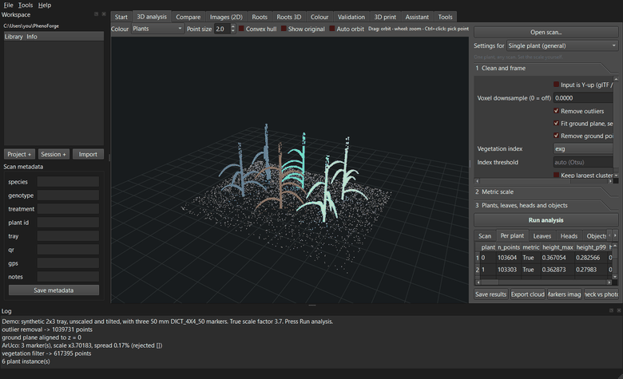

# The 3D analysis tab

This is the main screen. You open a 3D scan, choose settings, click **Run analysis** and read
the traits. The 3D view is on the left. Settings and results are on the right.

## Quick start

1. Click **Open scan...** and choose a scan (or drag it onto the window).
2. In **Settings for**, pick the preset that matches your job.
3. Check the three settings sections: **1 Clean and frame**, **2 Metric scale** and
   **3 Plants, leaves, heads and objects**.
4. Click **Run analysis**.
5. Read the results in the tabs under the button. Click **Save results** to write the files.

## The 3D view

### Moving around

| Action | How |
|---|---|
| Turn (orbit) the view | Drag with the left mouse button. |
| Zoom | Mouse wheel. |
| Move (pan) the view | Drag with the middle mouse button (wheel button). |
| Pick a point | Hold **Ctrl** and click a point. |

### The bar above the view

| Control | What it does |
|---|---|
| **Colour** | How points are coloured (see below). |
| **Point size** | Size of the dots on screen (0.5 to 12). In Splat mode, 2 is the natural splat size. |
| **Convex hull** | Draws the convex hull (the "shrink-wrap" shape) as yellow lines. After plants are separated and Colour is **Plants**, one hull is drawn per plant. |
| **Show original** | Shows the scan as loaded, before cleaning and scaling. Untick to see the analysed scan again. |
| **Auto orbit** | Turns the view slowly around the plant (20 degrees per second). Click in the view to stop. |

### Colour modes

| Mode | Shows |
|---|---|
| **RGB** | The scan's own colours. |
| **Splat** | Each point is drawn as a soft, see-through disc sized like the original Gaussian splat, which looks more like a photo. For ordinary point clouds the disc size comes from the spacing between points. This is an approximate splat display, not a full Gaussian-splat renderer. Selected automatically when you open a Gaussian-splat file. Up to 300,000 points are drawn. |
| **Height** | Colour by height (z): low is dark purple, high is yellow. |
| **Greenness (ExG)** | Colour by the Excess Green index of each point. |
| **Plants** | One colour per separated plant. Grey points belong to no plant. Selected automatically after the analysis finds plants. |
| **Leaves** | One colour per leaf candidate. Only available after an analysis with leaf candidates. |

The view shows at most 1.5 million points (a random subset of larger scans). The analysis
always uses all points.

### Picking points

Hold **Ctrl** and click a point. A red marker appears. PhenoForge keeps the last two picks.
When there are two, the Log shows the distance between them and the
**Picked:** line in section 2 shows it too (in m if the scan is metric, otherwise in scan
units).

Use this to measure something quickly, or to set the scale with **Two picked points**.

## Presets ("Settings for")

A preset sets the most important options for a common job. Choose one, then adjust anything
you need. The grey text under the box describes the preset.

| Preset | What it sets |
|---|---|
| Single plant (general) | Default settings: one plant, leaf candidates by components, vegetation index exg. Set the scale yourself. |
| iPhonotype app (.ftscan) | One plant, leaf candidates, Y-up off (packages are turned upright on loading). See [iPhonotype](iphonotype.md). |
| iPhone LiDAR app (PLY / OBJ / USDZ) | One plant, leaf candidates. Tick Y-up only if the plant lies on its side. |
| Photos or video with ArUco (Android, DSLR, turntable) | One plant, ArUco scaling with 50 mm markers. |
| Tray of touching plants | Plants separated by watershed, no leaf candidates. Enter the number of plants. |
| Bench of pots in a grid | Plants assigned to pots in a grid, no leaf candidates. Enter rows, columns and pot pitch. |
| Wheat: heads and tillers | One plant, leaf candidates, head and tiller counts, vegetation filter off. See [Wheat](wheat.md). |
| Fruit / objects on a bench | Object measurement on, no leaf candidates, vegetation filter off. See [Objects](objects.md). |

Choosing a preset changes Y-up, vegetation index, plants, leaf candidates, heads, tillers,
objects and the scale source. The "Photos or video with ArUco" preset selects **ArUco
markers** (50 mm). The other presets set **Already metric** when the open scan is metric (or no
scan is open), and the "iPhone LiDAR app" preset always does, because it treats the file as
metres. Otherwise the scale source is left as it is. Check section 2 after changing presets.

## 1 Clean and frame

| Setting | What it does | Default |
|---|---|---|
| **Input is Y-up (glTF / phone app export)** | Turns a scan that lies on its side upright. Tick it only if the plant lies on its side after loading. iPhonotype packages and USDZ files are turned upright automatically. GLB/glTF exports from phone apps usually need it. | Off |
| **Voxel downsample (0 = off)** | Thins out very dense scans to speed things up. The value is a cube size in the scan's own units (metres for metric scans, so 0.002 = 2 mm). Points in each cube are averaged. | 0 (off) |
| **Remove outliers** | Removes isolated stray points (flying pixels, dust). A point is removed when its mean distance to its 20 nearest neighbours is unusually large. | On |
| **Fit ground plane, set z = 0** | Finds the table, tray or soil plane and makes it z = 0, so height is measured from it. The plane is searched among the lowest 40 % of points so a big leaf is not taken for the ground. | On |
| **Remove ground points** | Deletes the ground points after levelling, so they do not count as plant. | On |
| **Vegetation index** | Keeps plant-coloured points. **exg**: green plants. **gli** and **vari**: other greenness indices. **hue**: keeps hues from 35 to 170 degrees, which includes straw-yellow heads and senesced leaves as well as green. **none**: keeps all colours (use for wheat heads, fruit, roots, or scans without colour). | exg |
| **Index threshold** | Leave empty to choose the threshold automatically (Otsu's method, capped at 0.10 for exg and 0.05 for gli and vari). For **hue**, a number here replaces the lower hue limit (35 degrees). | Empty (auto) |
| **Keep largest cluster(s) only** | Keeps only the biggest connected part(s), for example to drop a neighbouring plant or floating debris. Keeps as many parts as **Expected plants** (or one). | Off |

The steps run in this order: Y-up, downsample, outliers, ground fit, scale, ground removal,
vegetation filter, largest clusters. The scale is measured before the ground is removed, so
markers lying on the ground are still there.

If the vegetation filter removes almost everything (very few points left), see
[Troubleshooting](troubleshooting.md).

## 2 Metric scale

Traits are only in real units (metres) when the scan has a known scale. Choose a
**Scale source**:

### Already metric (LiDAR)

No scaling is applied, and the scan is treated as being in metres. Use it for scans that are
already in metres:

- iPhonotype packages whose scale the app marked as verified,
- USDZ files and LAS/LAZ files,
- LiDAR scanning-app exports (PLY, OBJ, GLB).

PLY, OBJ and GLB files carry no unit information. When you choose **Already metric**,
PhenoForge takes your word for it: the results are reported in metres and the scan history
says "treated as metres (file from a LiDAR app)". Only choose it when you know the file is in
metres. Photogrammetry and photo-based scans are never in metres.

What happens when a scan loads:

- A scan that is known to be metric (verified iPhonotype package, USDZ, LAS/LAZ): the scale
  source is set to **Already metric**.
- A scan without a known scale, with the "iPhone LiDAR app (PLY / OBJ / USDZ)" preset: the scale
  source stays **Already metric**, and the Log says the file is treated as metres.
- A scan without a known scale, with any other preset: the scale source switches to
  **ArUco markers**, and the Log explains the choices (ArUco, two picked points, or
  **Already metric** if the file is in metres).

### ArUco markers

Uses printed ArUco markers lying flat in the scene (on the soil, the tray, the bench or the
pot rims). PhenoForge draws a top view of the coloured scan, finds the markers, measures each
one closely and compares it with the printed size.

| Setting | What to enter |
|---|---|
| **Marker side** | The side length of one printed marker in mm, measured with a ruler (the black square, not the white border). |
| **Dictionary** | The marker family. PhenoForge's marker sheet uses DICT_4X4_50 by default. |
| **Marker IDs** | Leave empty to accept all markers. Or type the IDs to use, for example `0-8` or `0,1,2,3`. |

Markers whose size differs from the median by more than 4 % are rejected (a tilted or partly
hidden marker reads short). The Log shows the number of markers used, the scale factor, the
spread between markers (as a percentage) and any rejected IDs.

Use **Markers image** (below the results) to see which markers were found before you run
the analysis.

The scan must have colours, and the markers must be visible from above after the ground has
been levelled. Make a marker sheet on the [Tools](tools.md) tab.

### Two picked points

1. If you have already run an analysis, tick **Show original** first. Picks must be made on
   the original scan.
2. Ctrl+click two points whose real distance you know, for example two sides of the pot rim
   or two corners of a marker card.
3. Enter the real distance in **Distance between picks** (mm).
4. Click **Run analysis**.

### Manual factor

Multiplies all coordinates by the number you enter. For example, if the scan is in
millimetres, enter 0.001 to convert to metres.

## 3 Plants, leaves, heads and objects

| Setting | What it does |
|---|---|
| **Plants** | How to separate plants. **single**: the whole scan is one plant. **watershed**: touching plants in a tray, split at the low points between canopies in a top-down height map. **grid**: pots in rows and columns. **dbscan**: separate clumps that do not touch (seen from above). |
| **Expected plants (0 = auto)** | How many plants you expect. Helps watershed find the right number. Also used by Keep largest cluster(s). |
| **Pot grid rows**, **Pot grid columns**, **Pot pitch** | For **grid** only. The number of rows and columns, and the centre-to-centre distance between pots in mm (the same in both directions). All three must be filled in. |
| **Leaf candidates** | **components**: pieces of the plant that are not connected to each other. **region**: region growing on smooth surfaces; can split leaves that touch at an angle. **sam**: AI leaf separation (optional add-on, see [AI leaf separation](leaves-ai.md)). **none**: no leaves. |
| **Count wheat heads (spikes)** | Counts heads in the scan. A heuristic: check against hand counts. See [Wheat](wheat.md). |
| **Count tillers** | Counts tillers from stem cross-sections just above the ground. See [Wheat](wheat.md). |
| **Measure each object (fruit, tubers, seeds)** | Length, width, thickness, volume and colour of each separate object. See [Objects](objects.md). |

Plants are numbered from 0 in reading order: rows from the back (largest y) to the front,
then left to right.

With **grid**, the grid is centred on the middle of the plant points, and points more than
0.75 × pitch from every pot centre are left unassigned. If rows, columns or pitch is 0, no
plants are separated and the Log says "Pot grid skipped: enter rows, columns and pot pitch".

Leaf candidates are found separately inside each plant. They are "visible leaf candidates":
touching leaves may merge into one, and one leaf may be split. They are not guaranteed to be
biological leaves.

## Run analysis

Click **Run analysis**. The mouse pointer shows a busy cursor while it works; the Log shows
each step. Large scans can take a minute or more.

When it finishes:

- the view shows the cleaned scan (coloured by plant when plants were found),
- the result tables are filled,
- the tab shown first is **vs iPhonotype** for packages, otherwise **Objects** or **Heads**
  when those were measured, otherwise **Scan**,
- if the scan is not metric, the Log says so: values are then in scan units,
- if the scan was opened from the library, the results are saved there automatically
  ("results saved to the library").

## The result tabs

All lengths are in metres, areas in m² and volumes in m³ when the scan is metric. See the
[Trait glossary](traits.md) for every column.

| Tab | Contents |
|---|---|
| **Scan** | Traits of everything left after cleaning, as a two-column list (trait, value): height, spread, footprint, projected area, hull and voxel volume, surface (leaf) area, lean, colour indices, and head and tiller counts when they were measured. |
| **Per plant** | One row per separated plant, with the same traits. Empty when **Plants** is **single**. |
| **Leaves** | One row per leaf candidate: plant, leaf number, points, area, length, bounding box and centre. |
| **Heads** | One row per detected wheat head. See [Wheat](wheat.md). |
| **Objects** | One row per measured object. See [Objects](objects.md). |
| **vs iPhonotype** | PhenoForge's traits next to the iPhonotype app's own traits. Packages only. See [iPhonotype](iphonotype.md). |
| **Package** | Everything read from an iPhonotype package. Packages only. |

## Buttons under the results

### Save results

Choose a folder. PhenoForge writes these files (`<scan>` is the scan name):

| File | Contents |
|---|---|
| `<scan>_traits.json` | Everything: options used, scale, all traits and tables, processing history. |
| `<scan>_plant.csv` | One row: the Scan tab (with plant ID, genotype, treatment, operator and start time for packages). |
| `<scan>_plants.csv` | The Per plant tab. |
| `<scan>_leaves.csv` | The Leaves tab. |
| `<scan>_heads.csv` | The Heads tab. |
| `<scan>_objects.csv` | The Objects tab. |
| `<scan>_vs_iphonotype.csv` | The vs iPhonotype tab. |
| `<scan>_package.csv` | The Package tab. |

Only the tables that have rows are written. **File > Export results...** does the same.

### Export cloud

Saves the cleaned scan as PLY, PCD or CSV. A PLY file includes a `label` column (plant or
leaf number) when plants or leaves were separated. A CSV has columns x, y, z, r, g, b and
label. **File > Export cleaned cloud...** does the same.

### Markers image

Shows the top view that PhenoForge uses to find ArUco markers, with the markers it found
outlined and numbered. The window title gives the number of markers, the scale factor and
the spread. Below the picture, "Marker sides after scaling" lists each marker's size in mm;
they should all be close to your marker size.

It uses the **Marker side** and **Dictionary** from section 2. You do not need to run the
analysis first.

### Check vs photos

For iPhonotype packages: compares the 3D model with each photo in the package. See
[Validation](validation.md). If the open scan is not a package with camera positions,
PhenoForge asks you to choose a package.

## Other useful commands

- **File > Save view snapshot...** saves the current 3D view as a PNG picture.
- **Tools > Package information...** jumps to the Package tab.
- Use [Analyse a whole folder](batch.md) to run the same settings on many scans.
