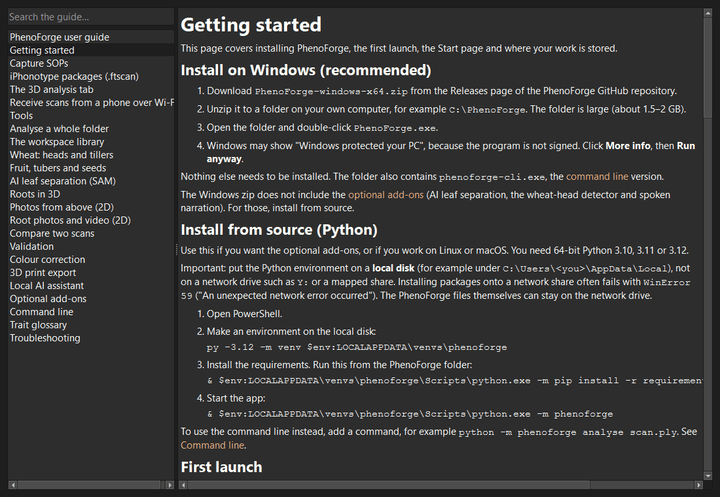

# Getting started

This page covers installing PhenoForge, the first launch, the Start page and where your
work is stored.

## Install on Windows (recommended)

1. Download `PhenoForge-windows-x64.zip` from the Releases page of the PhenoForge GitHub
   repository.
2. Unzip it to a folder on your own computer, for example `C:\PhenoForge`. The folder is
   large (about 1.5–2 GB).
3. Open the folder and double-click `PhenoForge.exe`.
4. Windows may show "Windows protected your PC", because the program is not signed. Click
   **More info**, then **Run anyway**.

Nothing else needs to be installed. The folder also contains `phenoforge-cli.exe`, the
[command line](cli.md) version.

The Windows zip does not include the [optional add-ons](addons.md) (AI leaf separation,
the wheat-head detector and spoken narration). For those, install from source.

## Install from source (Python)

Use this if you want the optional add-ons, or if you work on Linux or macOS. You need
64-bit Python 3.10, 3.11 or 3.12.

Important: put the Python environment on a **local disk** (for example under
`C:\Users\<you>\AppData\Local`), not on a network drive such as `Y:` or a mapped share.
Installing packages onto a network share often fails with `WinError 59` ("An unexpected
network error occurred"). The PhenoForge files themselves can stay on the network drive.

1. Open PowerShell.
2. Make an environment on the local disk:

   ```
   py -3.12 -m venv $env:LOCALAPPDATA\venvs\phenoforge
   ```

3. Install the requirements. Run this from the PhenoForge folder:

   ```
   & $env:LOCALAPPDATA\venvs\phenoforge\Scripts\python.exe -m pip install -r requirements.txt
   ```

4. Start the app:

   ```
   & $env:LOCALAPPDATA\venvs\phenoforge\Scripts\python.exe -m phenoforge
   ```

To use the command line instead, add a command, for example
`python -m phenoforge analyse scan.ply`. See [Command line](cli.md).

## First launch

The window has these parts:

- **Tabs** across the top: Start, 3D analysis, Compare, Images (2D), Roots, Roots 3D,
  Colour, Validation, 3D print, Assistant and Tools.
- **Workspace** panel on the left: your library of projects and scans. See
  [The workspace library](library.md).
- **Log** panel at the bottom: messages about what PhenoForge is doing, warnings and errors.
  Read it when something looks wrong.
- **Menus**: File, Tools and Help.

You can drag the Workspace and Log panels to other edges of the window, or close them.

## The Start page

The Start page asks "What would you like to do?". Click the job that matches your task.
PhenoForge chooses sensible settings and opens the right tab. You can still change every
setting afterwards.

| Group | Button | What it does |
|---|---|---|
| Scans from a phone or 3D scanner | Analyse an iPhonotype scan | Asks for a `.ftscan` package, opens it and runs the analysis straight away. See [iPhonotype](iphonotype.md). |
| | Analyse a 3D scan | Asks for a scan file and opens it in the 3D analysis tab with the "iPhone LiDAR app" settings. |
| | Receive from my phone (Wi-Fi) | Opens the [Wi-Fi receive](wifi.md) window with a QR code. |
| | Make 3D from photos or video | Opens the [Tools](tools.md) tab. |
| | Analyse a whole folder | Opens the [batch](batch.md) window. |
| What are you measuring? | A tray or bench of plants | Chooses the "Tray of touching plants" settings and asks for a scan. |
| | Wheat: heads and tillers | Chooses the wheat settings and asks for a scan. See [Wheat](wheat.md). |
| | Fruit, tubers or seeds | Chooses the object settings and asks for a scan. See [Objects](objects.md). |
| | Roots in 3D | Opens the [Roots 3D](roots-3d.md) tab. |
| | Photos from above (2D) | Opens the [Images (2D)](images-2d.md) tab. |
| | Root photos or video (2D) | Opens the [Roots](roots-2d.md) tab. |
| Check and compare | Compare two scans over time | Opens the [Compare](compare.md) tab. |
| | Check against hand measurements | Opens the [Validation](validation.md) tab. |
| | Check a scan against its photos | Opens the frame check for an iPhonotype package. See [Validation](validation.md). |
| Learn | Try the demo | Loads a synthetic tray with known answers. Press **Run analysis**. |
| | Read the user guide | Opens this guide. |

Under the buttons, **Recent scans** lists the last 10 scans you opened. Double-click one to
open it again.

## Try the demo first

1. On the Start page, click **Try the demo** (or use **Help > Load demo scan**).
2. A synthetic tray of six plants appears. It has three 50 mm ArUco markers on the soil.
   It is deliberately unscaled and tilted.
3. Click **Run analysis** on the right.
4. The plants are coloured one by one. The **Per plant** tab lists six plants. The Log
   shows the true scale factor so you can check the ArUco result.

**Help > Load demo root crown** loads a synthetic root crown for the [Roots 3D](roots-3d.md) tab.

## Opening scans

There are several ways to open a scan:

- **File > Open scan...** (Ctrl+O), or the **Open scan...** button on the 3D analysis tab.
- Drag one scan file from Windows Explorer onto the PhenoForge window.
- Double-click a scan in **Recent scans** on the Start page.
- Double-click a scan in the Workspace library.

Drag and drop of several files at once adds them to the library session that is selected in
the Workspace panel. If no session is selected, PhenoForge asks you to drop one scan or to
select a session first.

Supported 3D files: PLY (including Gaussian-splat PLY), PCD, XYZ, XYZRGB, PTS, TXT, CSV,
LAS, LAZ, OBJ, GLB, GLTF, STL, OFF, USDZ, USD, USDC, USDA, ZIP packages and iPhonotype
`.ftscan` packages.

## Getting help

- **F1** (or **Help > Help for this screen**) opens the guide page for the tab you are on.
- **Help > User guide** opens this guide. Type in the search box to find a word in any page.
- **Help > Getting started** opens this page.
- Hover the mouse over a setting to see a short tooltip.



## Where your work is stored

- The **workspace** is a folder for your library. By default it is `PhenoForge` in your home
  folder (for example `C:\Users\<you>\PhenoForge`). Change it with **File > Open workspace
  folder...**. See [The workspace library](library.md).
- Results are only written to files when you save them (**Save results** on the 3D analysis
  tab), when you analyse a scan that was opened from the library (saved automatically), or
  when you run a batch.
- Some tools suggest output folders inside `PhenoForge` in your home folder, for example
  `images_out`, `head_detector` and `scale_evidence`. You can change these each time.
