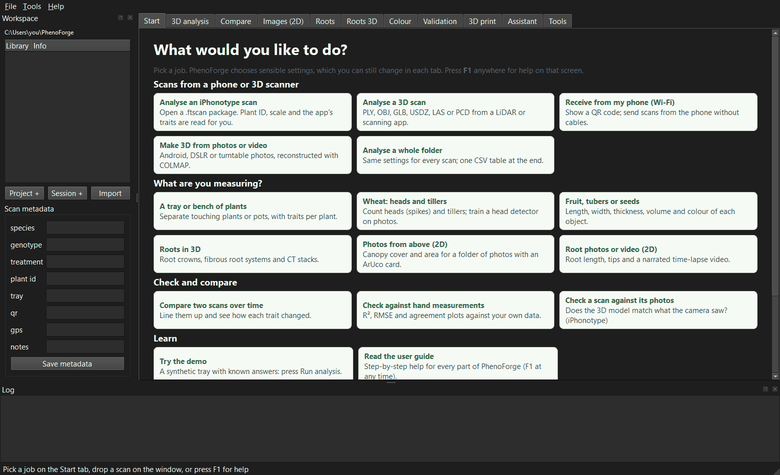

# PhenoForge user guide

PhenoForge measures plants from 3D scans and photos. It runs on your own computer. Nothing
is sent to the internet.

You give it a scan of a plant (from an iPhone, an Android phone, a camera or a 3D scanner).
It cleans the scan, sets the real-world size, separates plants and leaves, and gives you a
table of traits such as height, leaf area and volume. You can open the table in Excel or R.

Press **F1** on any screen to open the help page for that screen.

## First steps

- [Getting started](getting-started.md): install, first launch, the Start page and the workspace.
- [Capture SOPs](sops.md): how to capture good scans with each device.

## Scans from a phone or 3D scanner

- [iPhonotype packages (.ftscan)](iphonotype.md): open a scan from the iPhonotype iPhone app.
- [The 3D analysis tab](3d-analysis.md): open any 3D scan, set the scale and run the analysis.
- [Receive from a phone over Wi-Fi](wifi.md): send scans from the phone without cables.
- [Make 3D from photos or video, and other tools](tools.md): import from devices, COLMAP, marker sheets.
- [Analyse a whole folder](batch.md): the same settings for every scan, one table at the end.
- [The workspace library](library.md): projects, sessions, scans and metadata.

## What are you measuring?

- [Trays and pot grids](3d-analysis.md): see section 3 of the 3D analysis tab.
- [Wheat heads and tillers](wheat.md): head and tiller counts, and a head detector for photos.
- [Fruit, tubers and seeds](objects.md): length, width, thickness and volume of each object.
- [AI leaf separation (SAM)](leaves-ai.md): optional AI leaf instances.
- [Roots in 3D](roots-3d.md): root crowns, fibrous root systems and CT stacks.
- [Photos from above (2D)](images-2d.md): canopy cover and area for a folder of photos.
- [Root photos and video (2D)](roots-2d.md): root length, tips and a narrated time-lapse video.

## Check and compare

- [Compare two scans](compare.md): see how each trait changed between two scans.
- [Validation](validation.md): agreement with hand measurements, mask checks, and scan-versus-photo checks.
- [Colour correction](colour.md): correct colours with a 24-patch colour chart.

## More

- [3D print export](print.md): turn a scan into a multi-colour 3D print.
- [Local AI assistant](assistant.md): ask questions about a scan with Ollama.
- [Optional add-ons](addons.md): AI models and spoken narration.
- [Command line](cli.md): every command, with examples, for scripts and batch jobs.
- [Trait glossary](traits.md): what every output column means.
- [Troubleshooting](troubleshooting.md): common problems and fixes.

## A word on accuracy

PhenoForge has been tested on synthetic scans with known answers. Real plants are harder:
leaves hide each other, thin parts are lost, and scans are noisy. Before you publish numbers,
compare them with your own hand measurements on a subset of plants (see
[Validation](validation.md)).
