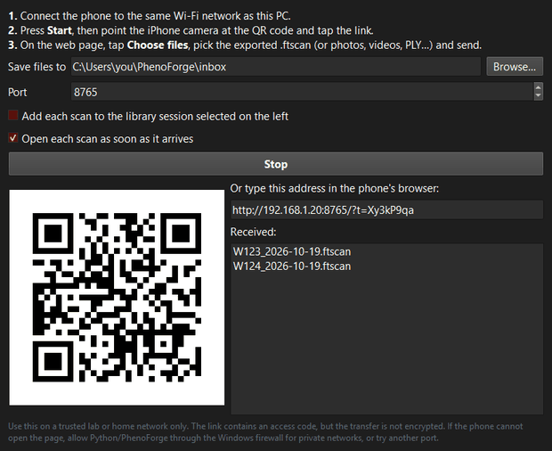

# Receive scans from a phone over Wi-Fi

You can send scans, photos and videos from a phone to PhenoForge over the local Wi-Fi
network, without cables or cloud accounts. PhenoForge runs a small upload page. The phone
opens it in its web browser (Safari on an iPhone) and you pick the files to send.

This is not automatic discovery: you start the receiver on the PC and open the link on the
phone each time.



## Before you start

- The phone and the PC must be on the **same network**. On a university network the PC and
  the phone may be on different networks (for example wired PC, eduroam phone). If the phone
  cannot open the page, ask IT, or use a lab Wi-Fi router that both can join.
- Use a **trusted** network only (a lab or home network). The link contains a random access
  code, so other people on the network cannot casually upload, but the transfer is **not
  encrypted**. Do not use it on public Wi-Fi.

## Send files from the phone

1. In PhenoForge, open **File > Receive from phone (Wi-Fi)...**. You can also use the Start
   page button **Receive from my phone (Wi-Fi)** or the Tools tab button
   **Receive from phone (Wi-Fi)…**.
2. Check the settings (see below) and click **Start**.
3. A QR code appears, and an address such as `http://192.168.1.20:8765/?t=...` appears under
   "Or type this address in the phone's browser:".
4. On the phone, point the camera at the QR code and tap the link. Or type the address into
   the phone's browser.
5. The page "Send scans to PhenoForge" opens. Tap **Choose files** and pick the files, for
   example the exported `.ftscan` from the Files app.
6. Tap **Upload**. Each file shows a progress bar and then **Done**.
7. Keep the page open until every file shows Done.
8. On the PC each file appears in the **Received:** list and in the Log.
9. When you have finished, click **Stop** or close the window. Closing the window stops the
   receiver.

The section "Received on the PC" at the bottom of the phone page lists what has arrived. It
refreshes every 5 seconds.

## Settings in the window

| Setting | What it does |
|---|---|
| **Save files to** | The folder where files are saved. By default the `inbox` folder in your workspace. |
| **Port** | The network port. 8765 by default. Change it if PhenoForge says it could not start on that port. The last port you used is remembered. |
| **Add each scan to the library session selected on the left** | Copies each received scan into the library session that is selected in the Workspace panel. Ticked automatically if a session is selected when you open the window. |
| **Open each scan as soon as it arrives** | Opens each received scan in the 3D analysis tab. Ticked by default. |

Only scan files are added to the library or opened (PLY, PCD, OBJ, GLB, GLTF, USDZ, USD,
LAS, LAZ, XYZ, ZIP, `.ftscan` and the other 3D types PhenoForge reads). Photos and videos
are saved to the folder only.

When both boxes are ticked, PhenoForge opens the library copy of each scan, so the results of
**Run analysis** are saved to the library automatically. See
[The workspace library](library.md).

## What files are accepted

The upload page accepts these file types: `.ftscan`, `.zip`, `.ply`, `.pcd`, `.obj`, `.glb`,
`.gltf`, `.usdz`, `.usd`, `.las`, `.laz`, `.xyz`, `.jpg`, `.jpeg`, `.png`, `.heic`, `.tif`,
`.tiff`, `.dng`, `.cr2`, `.nef`, `.arw`, `.mov`, `.mp4`, `.m4v`, `.json` and `.csv`.

Other types are refused with "Type ... not accepted". Files larger than 4 GB are refused.

If a file of the same name already exists in the folder, the new one is saved as
`name_1`, `name_2` and so on. Nothing is overwritten. A file is first written as
`name.part` and renamed when it is complete, so a broken transfer never leaves a half file
with the real name.

## Windows firewall

The first time you click **Start**, Windows may ask whether to allow PhenoForge (or Python)
to communicate on networks.

1. Tick **Private networks**.
2. Click **Allow access**.

If you clicked Cancel, the phone will not be able to open the page. Fix it in
**Windows Security > Firewall & network protection > Allow an app through firewall**, or
ask IT. On university-managed PCs you may need IT to allow it. See
[Troubleshooting](troubleshooting.md).

## If the phone cannot open the page

- Check both devices are on the same Wi-Fi network.
- Check the firewall (above).
- Try another port: click **Stop**, change **Port** (for example to 8800), click **Start** and
  scan the new QR code.
- If the page says "This link is missing its access code", scan the QR code again. Each
  time the receiver starts it makes a new access code.
- The address uses the PC's network address as PhenoForge sees it. On a PC with several
  network adapters (VPN, docking station) it may pick the wrong one. Disconnect the VPN and
  try again.

## From the command line

```
phenoforge receive --inbox D:\scans\inbox
```

This prints a QR code as text in the terminal and the address to open on the phone. Files
are saved to the inbox folder. Press Ctrl+C to stop. Options:

| Option | Meaning |
|---|---|
| `--inbox` | Folder for received files (default `phenoforge_inbox`). |
| `--port` | Port (default 8765). |
| `--token` | Fixed access code for the link (random if empty). |

The command line receiver only saves files; it does not analyse them. Analyse the folder
afterwards with `phenoforge analyse D:\scans\inbox --preset iphonotype`. See
[Command line](cli.md).
